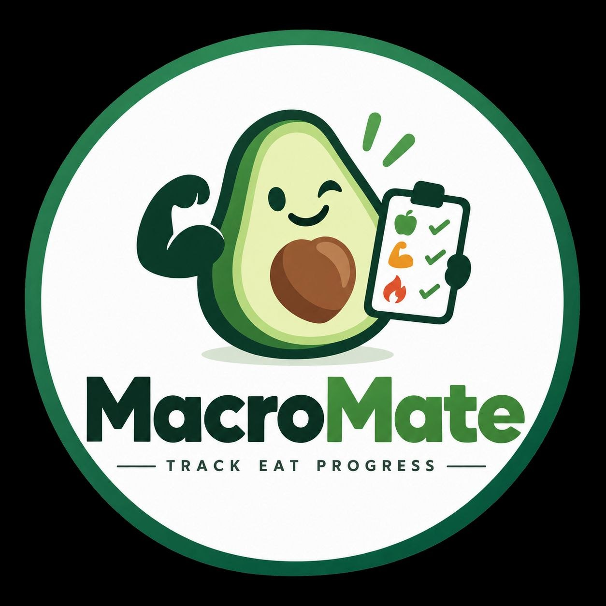

# MacroMate for Home Assistant

<p align="center">
  
</p>

A local meal and macro tracker that uses existing Garmin Connect sensors in Home Assistant and provides an interface for Hermes Agent.

> **Work in progress — not a production release.** Known test failures and security issues remain open. In particular, the companion client does not yet block cross-origin redirects, and mutation idempotency is incomplete. Do not use the client with a real Home Assistant token until these issues are fixed.

## Features

- Log meals with calories, protein, carbohydrates, and fat.
- List, update, and delete entries.
- Read weight and active calories from your existing Garmin Connect sensors.
- Use Garmin's basal metabolic rate (BMR) when available.
- Otherwise estimate BMR using `weight × kcal/kg`.
- Calculate a daily calorie target from BMR, active calories, and a calorie adjustment.
- Recommend protein and fat based on body weight; use the remaining calories for carbohydrates.
- Store meal data locally in Home Assistant's `.storage`.

The weight-based calculation is a configurable everyday estimate, not medical or nutritional advice. The calorie target is raised when needed to cover the recommended protein and fat.

## Install through HACS

[](https://my.home-assistant.io/redirect/hacs_repository/?owner=v4lle5&repository=macromate&category=integration)

HACS requires a public GitHub repository. The button opens the repository flow in your Home Assistant instance; it does not install the integration automatically or make it an official default HACS repository.

**The following steps are intended for development testing, not production use:**

1. Install HACS in your Home Assistant instance first.
2. Click the button and select your Home Assistant instance.
3. Add MacroMate in HACS and download it.
4. Restart Home Assistant.
5. Go to **Settings → Devices & services → Add integration → MacroMate**.

If the button does not offer to add the repository, use **HACS → ⋮ → Custom repositories** and add `https://github.com/v4lle5/macromate` with type **Integration**.

## Manual setup

1. Copy `custom_components/macromate` to `/config/custom_components/macromate`.
2. Restart Home Assistant.
3. Go to **Settings → Devices & services → Add integration → MacroMate**.
4. Select the following entities from your existing Garmin Connect integration:
   - Weight
   - Active calories
   - Optional: BMR / basal calories
5. Configure the factors. Defaults:
   - Estimated BMR: `22 kcal/kg`
   - Protein: `1.6 g/kg`
   - Fat: `0.8 g/kg`
   - Calorie adjustment: `0 kcal` — negative for a deficit, positive for a surplus

Common Garmin Connect entity names include `sensor.garmin_connect_weight`, `sensor.garmin_connect_active_calories`, and `sensor.garmin_connect_bmr_calories`. Actual IDs depend on your installation; the setup form uses entity selectors rather than hard-coded IDs. Weight sensors must provide a supported unit; energy sensors must provide kcal or kJ.

## Home Assistant actions

- `macromate.log_meal`
- `macromate.list_meals`
- `macromate.update_meal`
- `macromate.delete_meal`
- `macromate.clear_day`

### Log a meal

```yaml
action: macromate.log_meal
data:
  name: Oatmeal with banana
  meal_type: breakfast
  calories: 540
  protein: 24
  carbs: 78
  fat: 14
  request_id: "hermes-20261013-breakfast-1"
response_variable: meal
```

`request_id` is optional. Use a stable ID for the same logical add, but do not treat the current implementation as safe general-purpose idempotency: it does not reject changed payloads, and replaying an add after deletion can recreate the entry. A persistent operation ledger is still pending.

### List meals

```yaml
action: macromate.list_meals
response_variable: meals
```

The response contains entries, daily totals, and the current Garmin-based recommendation. **Known contract issue:** listed entries currently expose `id`, while update and delete expect `entry_id`. Until this is fixed, pass the returned `id` value as `entry_id`.

### Update a meal

```yaml
action: macromate.update_meal
data:
  entry_id: "ID_FROM_LIST_MEALS"
  calories: 510
  protein: 26
response_variable: corrected
```

### Delete a meal

```yaml
action: macromate.delete_meal
data:
  entry_id: "ID_FROM_LIST_MEALS"
response_variable: deleted
```

## Hermes Agent on the same network

No extra open port or separate web server is required. Hermes uses Home Assistant's authenticated REST API.

The included `tools/macromate_client.py` provides a command-line interface. **The client is not yet safe for production credentials because redirect handling remains unresolved.** The example below shows its interface only; configure secrets through your agent's secret manager before using a hardened version.

```bash
export HA_URL="https://ha.example.com"
# Supply HA_TOKEN through your secret manager or protected environment.

python3 tools/macromate_client.py list
python3 tools/macromate_client.py add \
  --name "Cereal" --meal-type breakfast --calories 430 \
  --protein 20 --carbs 61 --fat 12 \
  --request-id "hermes-20261013-breakfast"
python3 tools/macromate_client.py update ENTRY_ID --calories 410
python3 tools/macromate_client.py delete ENTRY_ID
```

Never put tokens in prompts, skills, logs, or chat messages. The client reads `HA_URL` and `HA_TOKEN` from its environment. Use HTTPS to protect bearer credentials in transit.

A short agent workflow is included in `agent-skill/SKILL.md`.

## Sensors

Depending on your installation and entity naming, generated entities may include:

- `sensor.kalorien_gegessen`
- `sensor.grundumsatz_empfehlung`
- `sensor.garmin_aktivkalorien`
- `sensor.kalorienempfehlung_heute`
- `sensor.kalorienbilanz`
- `sensor.proteinempfehlung`, `sensor.kohlenhydratempfehlung`, `sensor.fettempfehlung`
- Corresponding intake and balance sensors

These IDs retain the current integration's German naming. Home Assistant may change entity IDs to avoid naming collisions. Check the entity list in your instance for the actual IDs.

## Privacy

Meals stay local to Home Assistant. MacroMate does not contact Garmin directly; it reads the states of your existing Garmin Connect entities. Your Garmin Connect integration may use cloud polling separately.

Removing MacroMate deletes its local meal storage.

## Tests

```bash
python3 -m unittest discover -s tests -v
python3 -m compileall -q custom_components tests tools
```

The current test suite is not green: `tests/test_models.py` imports an `OperationLedger` that has not yet been implemented. Pure-Python and static contract checks also do not establish Home Assistant runtime compatibility. Full runtime and persistence testing is still required.

## Not included yet

- Barcode scanning or a food database
- Photo recognition
- Recipes and serving-size conversions
- A dedicated graphical meal-entry card

Reliable data paths first. Glitter later.
