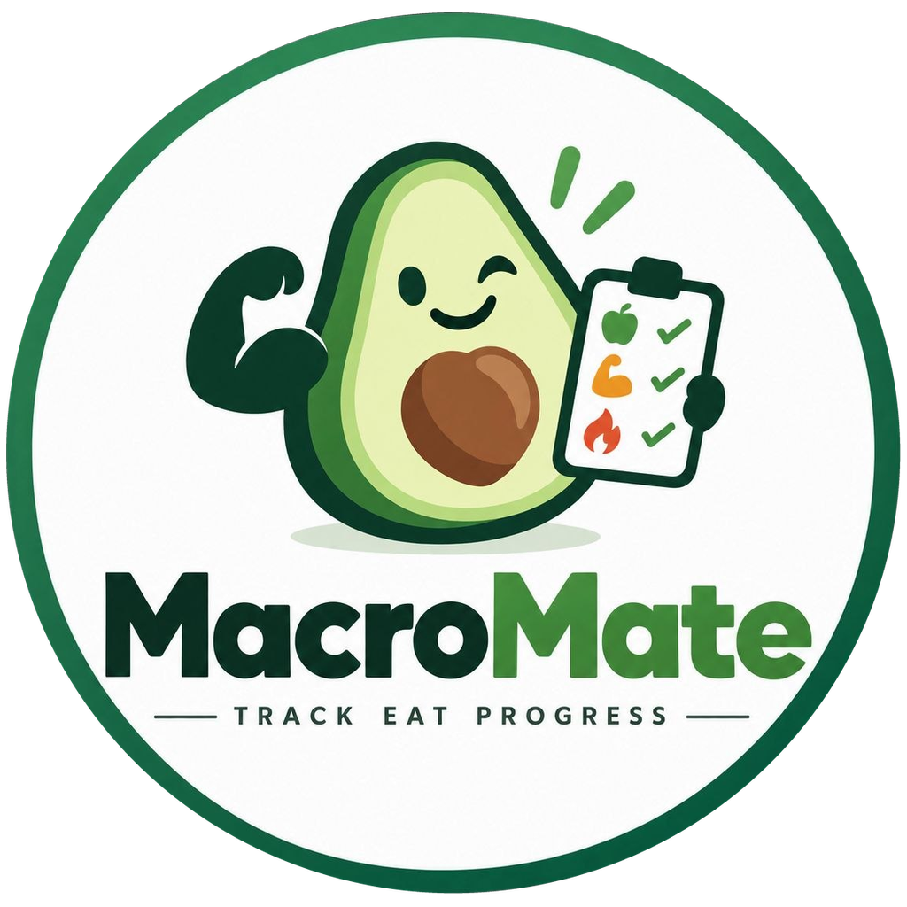

# MacroMate for Home Assistant

<p align="center"></p>

Local calorie and nutrient tracking inside Home Assistant. MacroMate provides its own food, portion and diary model, automatic nutrition goals, local storage and optional Open Food Facts lookup.

Development build, not a medical tool. Physical mobile cameras and iOS/Safari remain unverified; read the limits below before installing on a live instance.

## Features

- Responsive local MacroMate sidebar panel, using Home Assistant's existing authenticated connection.
- Automatic calorie and macro goals from a readable profile; no technical kcal/kg or protein/fat multipliers in normal onboarding.
- Date navigation, signed calorie balance and breakfast/lunch/dinner/snack groups with daily nutrient totals.
- Reusable foods: stable product ID, name, producer, explicit g/ml basis, declared nutrients, product-specific servings, exact barcode strings, source/licensing metadata and favorite portion templates.
- Per-100-g/ml label entry, normalized per-one-g/ml storage and portion conversion. No silent g↔ml conversion.
- Local text search, favorites, recent foods, custom foods and persistent offline product cache.
- Optional read-only Open Food Facts search and barcode lookup; disabled by default.
- Camera EAN-8/EAN-13 scanning, locally decoded barcode photos and bundled ZXing fallback. Manual lookup supports valid GTIN12/GTIN14 too.
- Quick entries store total nutrients; food entries store immutable label snapshots. Edit, delete and copy entries without later product changes rewriting their nutrition history.
- Extended nutrients with explicit kcal/g/mg/µg/ml units. Missing values remain unknown; declared zero remains zero.
- Local private storage, bounded persistent retry history, summary/goal sensors and authenticated actions for automations/agent clients.

No AI, recipes, fasting, photo-based food recognition, image uploads or analytics.

## Installation

[](https://my.home-assistant.io/redirect/hacs_repository/?owner=v4lle5&repository=macromate&category=integration)

HACS requires a public repository and a published revision containing this build. Local working-tree changes are not automatically available through HACS. The button opens the repository flow; it does not publish or automatically install this version.

For a local development installation:

1. Back up HA and its existing MacroMate config/storage.
2. Copy the entire `custom_components/macromate` directory to `/config/custom_components/macromate`, including `frontend/` and `brand/`. No npm build or extra server is needed at runtime.
3. Restart Home Assistant.
4. Add MacroMate under **Settings → Devices & services**, or open the existing entry's options.
5. Complete the profile. The sidebar panel is available to administrators when HA HTTP/frontend is enabled.

The isolated runtime is HA Core 2026.10.1 / Python 3.14.2. Pure model/client tests also run on Python 3.11; that does not establish older HA compatibility. Local branding is supported by HA 2026.3+; HACS pre-install listings may still show a placeholder.

## Profile, goals and Garmin

Setup collects birth date, physiological formula sex, height, current/target weight, loss/maintenance/gain intent, weekly pace, activity category and a named macro plan. MacroMate supports adults and bounded values only; support bounds are not medical recommendations.

Nutrition goal rules:

- BMR: `10 × kg + 6.25 × cm − 5 × age + offset`; complete calendar months / 12 for age, offsets −161/+5.
- PAL: 1.25 / 1.38 / 1.52 / 1.65.
- Signed weekly change: `750 × kg/week`, with target-weight BMR as a floor in the adjusting branch.
- Named macro shares use 4.1 kcal/g for protein/carbohydrates and 9.3 kcal/g for fat. Food-label energy is kept separately, not reconstructed from those goals.
- MacroMate stops the weight adjustment at or beyond the target weight.

Garmin entities are optional. Valid measured weight overrides profile weight; usable Garmin BMR overrides the formula. A current, explicitly selected **daily active energy** reading uses `BMR + active energy` instead of a PAL budget. Without it, PAL-based estimation is labeled fallback/estimated. Unknown activity is not a measured zero. Incorrect units, yesterday-dated activity, restored readings and explicitly total-energy readings are rejected for the active path.

The operator must choose a sensor that truly represents daily active energy: a kcal unit alone cannot establish semantics. Do not add total energy, overlapping workouts or steps again. MacroMate does not log into Garmin or poll wearables directly.

Goals are snapshotted by HA local date on setup/source updates and at local midnight. Historical dates without snapshots report unknown goals, never today's profile goal. Existing v1 config entries migrate without invented demographics; old entity IDs/internal factors and meals remain intact until the profile is completed in options.

## Food source, license and scanner

Enable the database in integration options, then explicitly enable online lookup for a submitted search/scan. Only that query/barcode goes to Open Food Facts, not profile/diary data. No per-keystroke network search. Camera frames and barcode photos are decoded locally and never uploaded. Camera access needs HTTPS or localhost plus browser permission.

OFF product reads use v3.6; text search uses documented legacy CGI because v2 structured search is not full-text search. GET-only requests have timeouts, response-size bounds, no redirects, rolling quotas, cooldowns and memory caches. Other applications behind the same IP still share upstream limits. Imported products persist locally for offline use.

Food data: **Open Food Facts contributors**, https://world.openfoodfacts.org — database **ODbL 1.0**, contents **DbCL 1.0**. Cached products retain attribution; it is displayed with results. Redistributing a derived database may invoke ODbL share-alike requirements. The integration's code license does not replace data licensing. Product images are not fetched. Community data can be incomplete or wrong: verify the label.

Barcodes are preserved as strings, including leading zeros. MacroMate requires ASCII GTIN8/12/13/14 syntax and a valid mod-10 checksum; no trimming, repair or integer normalization. A food without declared calories cannot be logged until a separate local product is completed. Unknown macros/micronutrients remain marked missing, and incomplete totals are partial known totals.

## Home Assistant actions

Private actions require an administrator when a user context is present. HA's admin-service helper permits userless internal automations as trusted: do not expose them through untrusted scripts/webhooks. Every custom WebSocket command and the sidebar panel is admin-only.

Read actions require response data:

- `macromate.list_meals`
- `macromate.search_foods`
- `macromate.get_food`
- `macromate.lookup_barcode`

Mutations optionally return a response:

- `macromate.log_meal`, `macromate.update_meal`, `macromate.delete_meal`
- `macromate.clear_day`, `macromate.copy_meal`
- `macromate.save_food`, `macromate.set_favorite`
- `macromate.log_food`, `macromate.update_food_entry`

Full fields are in `services.yaml`. Listed entries expose `entry_id`, matching update/delete. Product, diary-entry and request IDs are distinct.

For new quick entries, omitted optional macros are unknown, not zero. The `nutrients` map persists only declared values, while legacy numeric compatibility fields remain present. Explicit numeric zero is known. `update_meal` is a patch: omit a macro to retain it, or send `protein: null`, `carbs: null` or `fat: null` to clear its declaration. Energy cannot be cleared. The edit dialog sends null for blank optional macros; old records without declaration metadata retain their explicitly stored values as known.

Diary/meal-group `totals` sum declared values only. Always consult `nutrition_missing`: a listed nutrient is unknown in at least one contributing entry. Primary UI tiles label partial values **Unvollständig** and show only an explicitly labeled known sum, without an exact progress bar. Incomplete consumed/balance sensors publish **unavailable**, not zero or an exact remaining target. Automations must check state availability; HA can suppress custom attributes on unavailable entities. An empty day and explicitly declared zeros are complete.

Example label and serving (illustrative data; check your actual label):

```yaml
action: macromate.save_food
data:
  food:
    name: My oats
    base_unit: g
    nutrients_per_100:
      calories: 370
      protein: 13
      carbs: 60
      fat: 7
      fiber: 10
    servings:
      - serving_id: bowl
        label: Bowl
        amount: 60
  request_id: create-oats-1
response_variable: food
```

```yaml
action: macromate.log_food
data:
  food_id: "{{ food.food.food_id }}"
  serving_id: bowl
  quantity: 1.5
  meal_type: breakfast
  request_id: breakfast-oats-1
response_variable: meal
```

Choose a positive base `amount` OR `serving_id` plus `quantity`. `date` is HA-local YYYY-MM-DD; an explicitly selected date without a timestamp is placed at local noon. `eaten_at` must include a timezone and agree with an accompanying date. Copy creates a new ID and preserves the original snapshot.

Bulk deletion requires explicit date and confirmation:

```yaml
action: macromate.clear_day
data:
  date: "2026-10-14"
  confirm: true
  request_id: clear-20261014-1
```

This intentionally breaks v0.2's implicit today deletion. The panel has no bulk-clear UI.

## Safe retries and local storage

Meals, products, favorites, dated goals and ledger share an atomically written Store with an internal versioned schema. Mutation order is serialized replay → validation/staged change → durable save → publication. Failed saves do not publish changed in-memory state.

A stable `request_id` replays the original result only for identical retained operation/payload. Changed data or another operation with that ID is rejected. Create retries after deletion do not resurrect entries. The FIFO ledger retains **1000 accepted operations**; evicted IDs have no retry guarantee. Direct ledger hashes distinguish JSON `1` from `1.0`; normal API numeric fields are normalized.

The panel never automatically retries writes. Unclear transport/storage status keeps the original payload/ID for explicit retry. Pending requests exist only in panel memory: after closing/reloading during an uncertain write, inspect the diary before submitting again. Removing MacroMate through HA deletes its local dataset.

An authorized open panel subscribes to native `macromate_updated` events, coalescing bursts. A one-minute fallback catches missed events and HA-local date changes. Background refresh reads only the diary, waits for open dialogs and active/uncertain writes, preserves explicitly selected historical dates, and cleans up timers/subscriptions on disconnect. No background provider search or automatic write retry is performed.

## Agent client

`tools/macromate_client.py` uses HA's authenticated REST service API. Supply `HA_URL` as a credential-free HTTPS origin and `HA_TOKEN` through a protected environment/secret manager. Never paste tokens into chat, files, skills, logs or URLs. These private actions need an appropriate HA administrator identity; HA tokens are not fine-grained MacroMate-only scopes.

Redirects are always refused. Plain HTTP requires `--trusted-lan-http` before the subcommand and does not make an untrusted network safe.

```sh
python3 tools/macromate_client.py list --date 2026-10-14
python3 tools/macromate_client.py add --name Lunch --meal-type lunch --calories 500 --request-id lunch-1
python3 tools/macromate_client.py update ENTRY_ID --calories 450 --request-id correction-1
python3 tools/macromate_client.py delete ENTRY_ID --request-id delete-1
python3 tools/macromate_client.py clear-day --date 2026-10-14 --confirm --request-id clear-1
```

The CLI covers diary CRUD; its `call_service` function supports the other food actions. HTTP/protocol errors are sanitized and HA response envelopes unwrapped.

## Privacy boundary and verification limits

Detailed diary entries are not exposed in sensor attributes. Daily intake, goal and weight summaries remain normal HA entities governed by HA permissions. This is not a separately encrypted medical vault in a shared HA instance. HA administrators, local storage/backups and trusted automations can access the dataset.

- Physical cameras, autofocus/lighting, Android/iOS hardware and Safari remain unverified. Generated EAN images and actual Chromium virtual-camera frames were tested, not substituted decode results.
- Firefox checks exist; WebKit was blocked by missing host libraries.
- OFF mapping/HTTP behavior was tested with offline synthetic TLS fixtures, not a promise of live product coverage or availability.

- No live HA instance was changed; no local build is automatically published. HACS/hassfest CI is distinct from local runtime acceptance.

## Development checks

```sh
python3 -m unittest discover -s tests -v
```

Framework/provider tests can skip without HA/aiohttp. Use HA 2026.10.1 / Python 3.14.2 for those and coordinator/runtime boundary tests:

```sh
python -m unittest discover -s tests -v
python -m unittest discover -s tests/ha -v
python -m compileall -q custom_components tests tools
```

Browser/decoder commands and exact scratch dependency pins: `frontend/README.md`. Evidence and limits: `tests/frontend/evidence/README.md`. HACS installs the mirrored `custom_components/macromate/frontend` copy; after deliberate frontend changes mirror it there too. `test_panel_packaging.py` rejects stale/missing packaged assets.

Browser contract tests now replay captured form submissions through the actual HA coordinator. Set `HA_PYTHON` to a Python 3.14.2 interpreter with `homeassistant==2026.10.1` installed before running the Node suite; the CI frontend job installs that pinned runtime rather than skipping those assertions.
