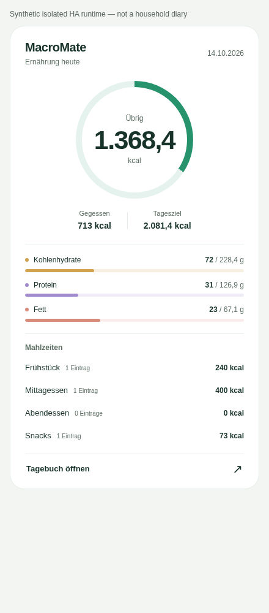
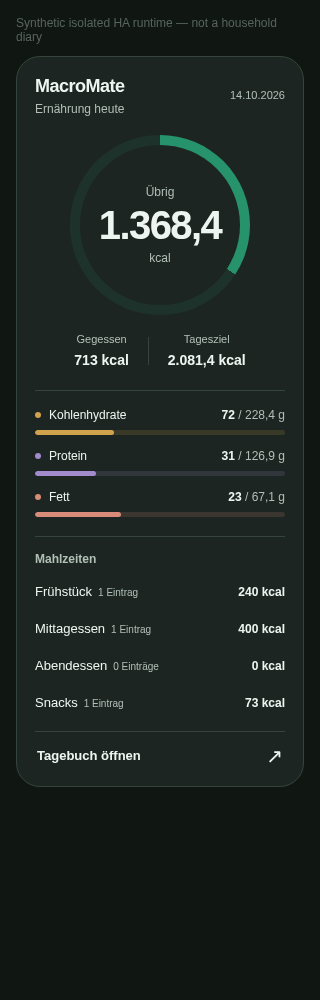

# MacroMate dashboard card

A local, read-only Home Assistant dashboard card: daily calorie balance, macro progress and meal-group summaries. The card opens the existing MacroMate diary for editing; it does not submit food entries or other mutations.

## Preview

Actual Chromium captures against an isolated Home Assistant 2026.10.1 runtime with explicitly synthetic diary entries, not a household deployment:




## Requirements

- A configured MacroMate integration with its authenticated `macromate/command` diary API.
- An integration revision containing `frontend/macromate-card.js` and `frontend/macromate-card.css`. A version number alone does not establish that these files are installed.
- A Home Assistant administrator account. Private diary access follows the integration's existing administrator-only authorization; putting the card on a dashboard does not grant other users permission.
- Check the integration's minimum Home Assistant version and validation status before upgrading a live instance. The card does not repair unrelated integration or release-validation failures.

## Add the resource

After installing a revision that includes the card, restart Home Assistant if the integration was updated. Enable advanced mode in your Home Assistant user profile if the dashboard resource controls are hidden.

Open **Settings → Dashboards → the three-dot menu → Resources** and add:

- URL: `/macromate-assets/macromate-card.js?v=card1`
- Resource type: **JavaScript module**

The `/macromate-assets/` route is provided by the configured integration. Updating the integration does **not** automatically register a dashboard resource.

For dashboards configured in YAML mode, add the same URL as a module in the dashboard resources instead of adding it again in the UI:

```yaml
resources:
  - url: /macromate-assets/macromate-card.js?v=card1
    type: module
```

## Add the card

Edit a dashboard, add a **Manual** card, and enter:

```yaml
type: custom:macromate-card
```

A copyable example is in `examples/macromate-dashboard.yaml`. No entity IDs, long-lived access tokens, external fonts or additional custom-card dependencies are required. Home Assistant provides the existing authenticated connection.

## Data and privacy

- The date and daily totals come from Home Assistant's diary API, not the browser's local timezone.
- Missing nutrient values are not filled with zero. Incomplete totals and unavailable goals are displayed explicitly rather than as exact balances or complete progress.
- Exceeding a calorie goal is distinguished from having calories remaining. Progress visuals do not change the underlying reported balance.
- The card only reads the diary. Its diary link opens `/macromate`, where the integration's existing entry forms remain responsible for editing.
- Diary updates trigger refreshes; a periodic fallback picks up missed events and date changes. Removal from the dashboard releases the card's timers and subscriptions.
- Code and styles are served locally. There are no external analytics, image uploads or added credentials.

## Troubleshooting

**Custom element doesn't exist: macromate-card**: confirm the resource is registered as a JavaScript module and that its URL returns JavaScript rather than a 404 page. Reload the dashboard/browser after adding it.

**Resource returns 404**: the installed integration may predate the card, may not be configured, or may need a restart. Check that both card files exist under `/config/custom_components/macromate/frontend/`.

**Permission message**: use an authorized administrator account. Do not bypass the server's access restrictions.

**Goal unknown**: complete the MacroMate profile in the integration options. Missing goals are not an instruction to eat zero calories.

**UI still looks old after an update**: refresh the dashboard and clear its frontend cache if necessary. Keep only one registration of the card resource.

Browser fixtures and screenshots use explicitly synthetic data. Browser test success alone does not establish physical-device, mobile Safari or live household deployment coverage.

## Local verification

- Full Node/Chromium suite: 82 passing tests, including the dashboard card.
- Card suite repeated against the installable component assets: 22 passing tests.
- Python test discovery with HA installed: 93 passing tests; HA boundary suite: 52 passing tests.
- Packaged JavaScript and CSS were served by actual HA HTTP and byte-matched against the installed files.
- Native authenticated WebSocket diary reads and an actual update event refreshed the displayed totals. Independent Store readback confirmed the card submitted no writes.
- A real read-only HA user was denied diary access; a client identity downgrade cleared displayed private data.
- Light/dark captures at 320, 440 and 1080 pixels had no horizontal overflow, unhandled browser errors or external requests.
- The disposable runtime was stopped and its short-lived refresh tokens were removed, including persisted credentials.

These local results complement the publication checks; check GitHub Actions for the exact revision being installed. They do not claim an end-to-end test of the full native Lovelace editor, mobile Safari or a live household deployment. Passing CI does not itself create a tagged release.
