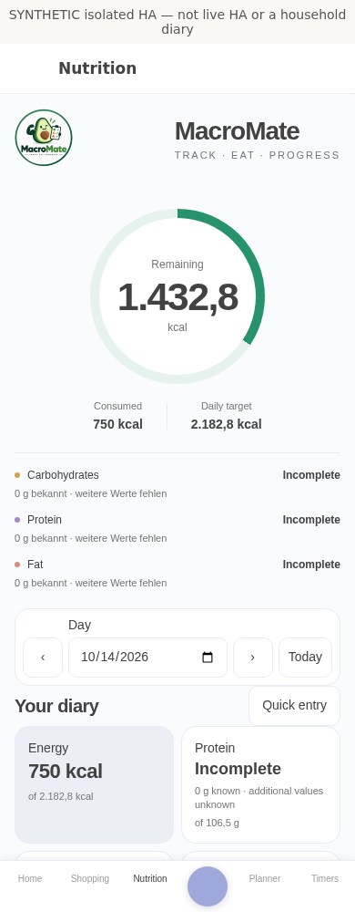
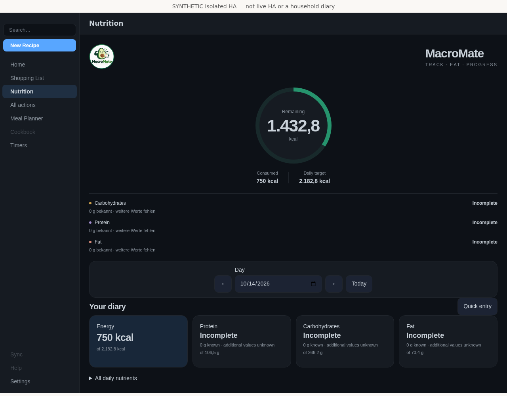

# MacroMate dashboard card

One local Home Assistant card for recipes, weekly planning, cooking timers and nutrition. The nutrition pane retains the calorie ring, macro overview, food database, scanner and diary editing. The original compact read-only overview remains available explicitly with `mode: summary`.

This is a development candidate. A local checkout is not automatically published, installed or registered in a dashboard. Do not delete/re-add an existing integration as an upgrade procedure.

## Preview

Actual Chromium captures from a disposable Home Assistant 2026.10.1 instance. All diary data is synthetic; these are not household screenshots or proof of physical-device acceptance.

## Install the complete integration first

1. Back up HA and the existing MacroMate configuration/storage.
2. Copy the complete `custom_components/macromate` directory into `/config/custom_components/macromate`, including every frontend chunk, source adapter, notice and brand asset. Do not copy only `app.js` or the two root card files.
3. Restart Home Assistant and retain the existing integration entry. Complete its profile/options if necessary. HACS can download this candidate only after a corresponding revision is actually published.

The tested framework is HA 2026.10.1 / Python 3.14.2. No npm server, separate recipe/shopping integration or additional runtime custom-card dependency is required. Optional remote lookups/imports need explicit consent. Camera access requires HTTPS or localhost and browser permission.

## Add the full dashboard app — no resource URL or YAML

After the integration is loaded and Home Assistant has been restarted, MacroMate automatically loads its card module using HA's native extra-module API (the same approach as the pinned Recipe Manager integration). This works with storage and YAML dashboards without editing either resource store. No separate frontend installation is needed. Existing manually configured resources are left untouched; you do not need to add another one.

1. Open the dashboard you want to use and choose **Edit dashboard**.
2. Add a view, or choose **Edit view** for an existing one. Under **Layout**, select **Panel (single card)** (German: **Panel (einzelne Karte)**).
3. Choose **Add card → By card**, search for **MacroMate**, select it and **Save**. Leave **Display → Full application** selected. Add it as the **only card** in that view.
4. Finish editing. Recipes, Meal Planner, Timers and Nutrition are inside this one full-width, responsive dashboard card.

The view URL/path is just a normal name such as `macromate` — **never paste a `.js` resource URL into the view URL field**. The dashboard card is the only MacroMate UI entry point. The separate diary-only sidebar menu has been removed; internal card navigation is unchanged.

The visual editor also offers **Compact summary (read-only)** for a small overview. Existing `mode: summary` cards keep their original behavior. Advanced users can still configure `type: custom:macromate-card` and `mode: summary` in YAML, but ordinary storage-dashboard setup does not require YAML, a resource URL, entity IDs or an extra bearer token.

The default combined card is editable according to server permissions. The card fills the available space below HA's dashboard header, including narrow/mobile and short landscape views; content scrolls inside the app rather than forcing a 550px minimum height.

## Permissions, data and connected workflows

Private nutrition, recipes and planning require an administrator. Internal shopping is retired; historical records stay preserved but have no operational action endpoints. A read-only HA identity cannot mutate data. Dashboard placement does not grant access; the server enforces permissions for both UI and agents.

Adding a plan does not silently log calories. Recipe → diary logging is a separate confirmed portion operation; saved nutrition snapshots survive later source edits/deletion. Unknown nutrients stay unknown, not zero. Incomplete totals do not imply exact progress, and over-goal intake is distinct from calories remaining.

The interface uses dedicated recipe editing, portion logging, weekly planning, timer/preset and settings/import/export workflows. The generic action editor has been removed. The authenticated API and agent clients remain available independently; API coverage is not evidence of a graphical editor for every optional field. Inert upstream Cookbook/Sync/Help placeholders remain disabled.

Refresh events coalesce. Safe list metadata can refresh while a recipe editor is dirty; protected recipes/dates/drafts/focus are retained. Uncertain mutations retain their exact request and UUID for explicit retry only. Identity changes/removal clear private UI state and release subscriptions, cameras and object URLs. Private recipe photos use authenticated local media routes; barcode camera frames are decoded locally, not uploaded for recognition.

## Verification and limits

The local candidate has executable coverage for native authenticated HA HTTP/WebSocket CRUD, exact durable Store readback, backup/restore, membership revocation, unknown/zero nutrition and lost-response explicit replay. Frontend checks exercise real barcode pixels/virtual camera frames, source/domain/coordinator workflows, themes, forms and context cleanup. Build tests compare every generated output and both manifests across clean dependency directories and relocated checkouts. Complete source/installable inventories and bytes must match **after** rebuilding and **before** native acceptance.

These are different evidence tiers, not interchangeable claims. The feature inventory is in `UNIFIED_FEATURE_MATRIX.json`; build commands and evidence boundaries are in `../frontend/unified-src/README.md`; agent CRUD/transfer contracts are in `AGENT_API.md`. Local tests are not a GitHub Actions result for an unpublished revision.

Native Lovelace acceptance covers the actual served HA dashboard, visual card picker/save, panel view, desktop/mobile/landscape dimensions and view-removal cleanup. Native HA form-component input is separately submitted to HA's options-flow manager; this is not an end-to-end integration-settings dialog test. Physical cameras, iOS/Safari/WebKit, live OFF coverage and live Garmin devices remain unverified. Some nutrition summary wording/number formatting still follows German conventions in an English UI. The card is not a medical tool.

## Troubleshooting

- **Custom element missing / 404:** verify the complete installed frontend, configured integration, HA restart and automatic module loading. No resource URL belongs in the view URL field. A version number alone does not prove the files are present.
- **Old UI:** updates now register `/macromate-assets/releases/<sha256>/loader.js` automatically. Every runtime dependency (including lazy modules, CSS and images) comes from that same content-addressed directory. A small build revision appears above the app. Existing manual `/macromate-assets/macromate-card.js` module resources, including old query strings, remain supported; the integration never rewrites dashboard resource records. If an older card class is already defined in this page, an explicit `registration_conflict` banner requests a page reload instead of silently retaining it or mixing modules. Restart HA after Python updates, then reload the page. Only if the conflict persists, inspect the actual loaded script URL and any duplicate manual resources; do not delete dashboards or integration data.
- **Read failure versus uncertain write:** failed reads show a safe operation/error category and do not imply a saved mutation. Only an actually pending mutation offers explicit same-request retry. The revision/status includes no provider response, credentials or submitted data.
- **Permission denied:** use an identity authorized for the exact domain/object; do not bypass server restrictions.
- **Unknown goals:** complete integration profile/options. Missing goals are not an instruction to consume zero calories.
- **Uncertain write:** inspect the exact target before an operator-approved identical-ID retry. Never create a replacement UUID merely to hide uncertainty.
